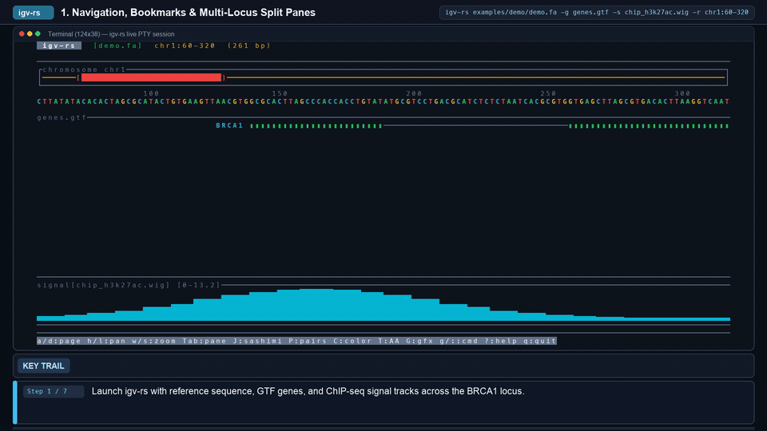
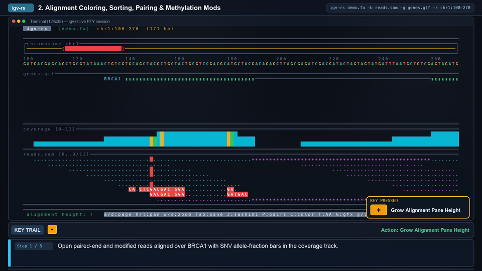
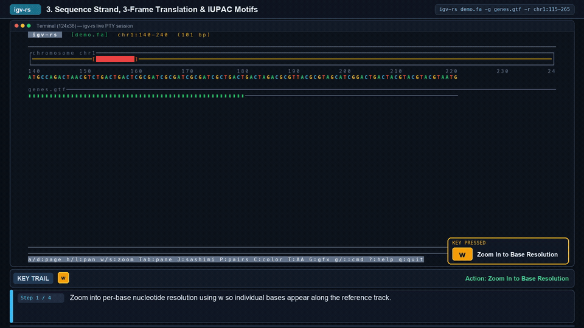
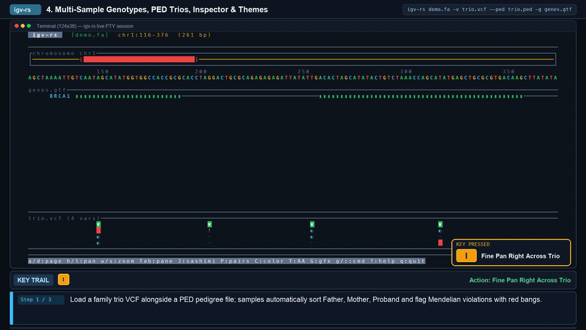
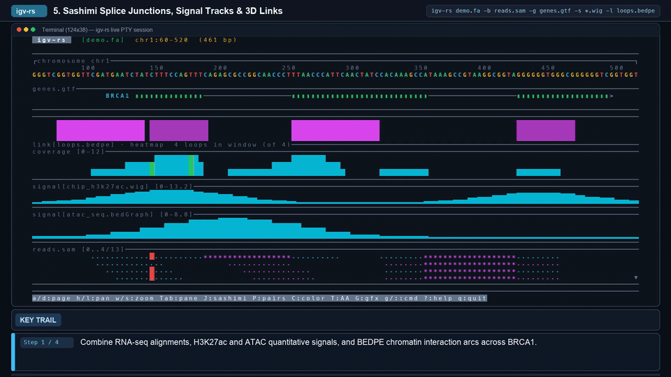
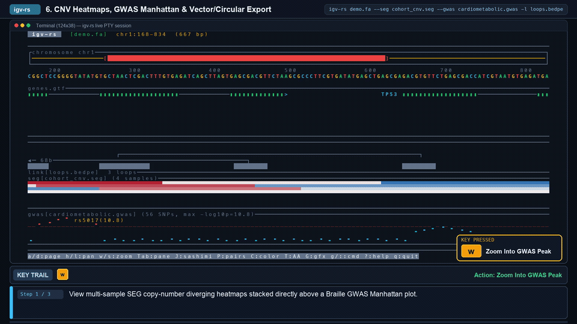
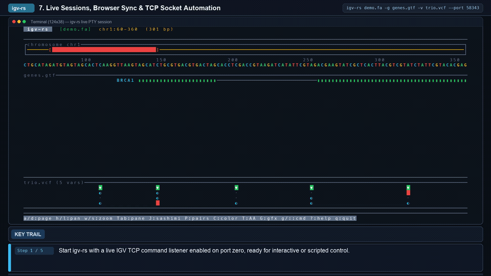

# igv-rs

Interactive terminal & headless genome viewer written in Rust, supporting local files and HTTP/S3/GS remote byte-range streaming across alignments, variants, pedigrees, annotations, quantitative signals, chromatin interactions, CNV segments, and GWAS Manhattan plots.

Inspired by [IGV](https://igv.org) and [cligv](https://github.com/jonasfreudig/cligv).

---

## Visual Feature Tour (Videos & Narratives)

Every walkthrough below was captured from a live `igv-rs` PTY session using [`examples/demo/`](examples/demo/), with **on-screen keystroke callouts (`KEY PRESSED` + `KEY TRAIL`)**, **synchronized voice narration**, and detailed **narrative guides** in [`docs/tutorials.md`](docs/tutorials.md).

### 1. Navigation, Bookmarks & Multi-Locus Split Panes
> Pan smoothly (`a`/`d`/`h`/`l`), zoom symmetrically (`w`/`s`), resolve gene names (`:TP53`), pin Vim-style bookmarks (`m<a>` / `'<a>`), inspect up to 4 loci side-by-side (`:split`, `Tab`), and view in-app help (`?`).



**[Watch Narrated 1080p Video (`.mp4`)](docs/videos/01-navigation-and-panes.mp4)** · **[Read Step-by-Step Narrative](docs/narratives/01-navigation-and-panes.md)**

---

### 2. Alignment Coloring, 5mC Methylation, Pairing & Sorting
> Toggle View-as-Pairs (`P`), cycle 8 biological color modes (`C`: `strand`, `insert`, `pair`, `mate`, `tag`, `mapq`, `MM`/`ML` `mod`, `bisulfite`), sort pileups at a heterozygous SNV (`:sort base`), group haplotypes (`:group hp`), and inspect soft-clips (`:softclip on`).



**[Watch Narrated 1080p Video (`.mp4`)](docs/videos/02-alignment-analytics.mp4)** · **[Read Step-by-Step Narrative](docs/narratives/02-alignment-analytics.md)**

---

### 3. Reference Strand, 3-Frame Translation & IUPAC Motif Search
> Zoom to nucleotide resolution (`w`), expand 3-frame amino-acid translation tracks (`T`), enable dual complementary strands (`:strand both`), switch to reverse translation (`:translate rev`), and highlight degenerate IUPAC motifs (`:motif TATAWAW`, `:motif GAATTC`).



**[Watch Narrated 1080p Video (`.mp4`)](docs/videos/03-sequence-and-motifs.mp4)** · **[Read Step-by-Step Narrative](docs/narratives/03-sequence-and-motifs.md)**

---

### 4. Multi-Sample VCF/BCF Genotypes, PED Trios, Modal Inspector & Themes
> Visualize cohort genotypes and `--ped` family trios (`Father → Mother → Proband`) with automatic Mendelian violation (`!`) flagging, click reads/variants/genes/SNPs with the mouse for a modal detail popup, and cycle across 8 terminal themes (`t`).



**[Watch Narrated 1080p Video (`.mp4`)](docs/videos/04-variants-and-pedigree.mp4)** · **[Read Step-by-Step Narrative](docs/narratives/04-variants-and-pedigree.md)**

---

### 5. RNA-seq Sashimi Splice Junctions, Quantitative Signals & 3D Links
> Overlay spliced `N`-operator RNA-seq Sashimi arcs (`J`) above coverage histograms, resize quantitative `bigWig`/`WIG`/`bedGraph` and `BEDPE`/`bigInteract` tracks (`}` / `>`), switch shared vs. per-track Y-scales (`\`), and set aggregation (`:summary mean`).



**[Watch Narrated 1080p Video (`.mp4`)](docs/videos/05-sashimi-signals-and-links.mp4)** · **[Read Step-by-Step Narrative](docs/narratives/05-sashimi-signals-and-links.md)**

---

### 6. CNV Heatmaps, GWAS Manhattan & Vector / Circular Exports
> Explore cohort copy-number segmentation heatmaps (`--seg`), high-density Braille GWAS Manhattan plots (`--gwas`), export SVG/PNG snapshots (`S` or `:snapshot`), and generate whole-genome Circos-style SV + CNV chord plots (`:circular` / `--circular-out`).



**[Watch Narrated 1080p Video (`.mp4`)](docs/videos/06-cnv-gwas-and-snapshots.mp4)** · **[Read Step-by-Step Narrative](docs/narratives/06-cnv-gwas-and-snapshots.md)**

---

### 7. Live Track Hot-Loading, Sessions, Browser Sync & TCP Automation
> Dynamically `:load` / `:unload` tracks and `:genome` presets without restarting, persist `.toml` or import IGV `.json` sessions, sync bidirectionally with the embedded `igv.js` web companion (`B`), and drive `igv-rs` externally over `--port` TCP sockets or `--batch` scripts.



**[Watch Narrated 1080p Video (`.mp4`)](docs/videos/07-sessions-batch-and-automation.mp4)** · **[Read Step-by-Step Narrative](docs/narratives/07-sessions-batch-and-automation.md)**

---

## Install & Quickstart

```bash
# Build release binary from source
cargo build --release
# Or install into ~/.cargo/bin
cargo install --path crates/igv-rs
```

Try the included reproducible dataset in [`examples/demo/`](examples/demo/):

```bash
# Multi-track interactive session over BRCA1/TP53
./target/release/igv-rs examples/demo/demo.fa \
  -b examples/demo/reads.sam \
  -v examples/demo/trio.vcf \
  --ped examples/demo/trio.ped \
  -g examples/demo/genes.gtf \
  -s examples/demo/chip_h3k27ac.wig \
  -l examples/demo/loops.bedpe \
  --seg examples/demo/cohort_cnv.seg \
  --gwas examples/demo/cardiometabolic.gwas \
  -r chr1:60-360

# Run a headless batch workflow and generate figures
./target/release/igv-rs --batch examples/demo/batch_example.igv
```

---

## Supported Formats & Remote Streaming

| Track Category | CLI Flag | Supported Formats & Indexing |
|---|---|---|
| **References & Genomes** | `[FASTA]` / `--genome` | Indexed FASTA (`.fa`/`.fasta` + `.fai`), UCSC `.2bit`, built-in presets (`hg38`, `hg19`, `mm39`, `mm10`, `danRer11`, `dm6`, `ce11`, `sacCer3`), `.json` descriptors, cytoband ideograms, `1`↔`chr1` aliases |
| **UCSC Track Hubs** | `--hub` | Remote or local `hub.txt` (`useOneFile on` as well as multi-file `genomes.txt` + `trackDb.txt`) |
| **Alignments** | `-b` / `--bam` | `BAM` (`.bai`/`.csi`), `CRAM 3.0+` (`.crai`/sequential), `SAM`, `PAF` |
| **Variants & Pedigrees** | `-v` / `--vcf`, `--ped` | Multi-sample `VCF` (`.vcf.gz` + `.tbi`/`.csi` or plain `.vcf`), `BCF 2.2`, 6-column `.ped` trios |
| **Annotations** | `-g` / `--annotation` | `GFF3`, `GTF`, `BED3`–`BED12`, `narrowPeak`, `broadPeak` (`.tbi`/`.csi` or gz), UCSC `bigBed` (`.bb`) |
| **Quantitative Signals** | `-s` / `--signal` | `bigWig` (`.bw`/`.bigwig`), `WIG` (`fixedStep`/`variableStep`), `bedGraph` (`.tbi`/gz; `--signal-summary max\|mean\|min\|sum`) |
| **Interaction Links** | `-l` / `--link` | `BEDPE` (`.bedpe`/`.bedpe.gz` + `.tbi`/`.csi`), UCSC `bigInteract` (`.inter.bb`) |
| **Copy Number & GWAS** | `--seg`, `--gwas` | `SEG`/`CBS`/`CN` log2 segmentation tables, `GWAS`/`ASSOC` summary stats |

All file/reference flags accept local paths as well as `http://`, `https://`, `s3://`, and `gs://` URLs streamed through a **64 KiB LRU page-cached HTTP byte-range reader** (pass `--auth-token <TOKEN>` for protected endpoints).

---

## Keybindings & Mouse Controls

### Navigation, Panes & Inspection
| Key / Input | Action |
|---|---|
| `a` / `←` and `d` / `→` | Page backward / forward (one full window) |
| `h` and `l` | Fine pan left / right (1/10 window) |
| `w` / `↑` and `s` / `↓` | Zoom in / out symmetrically around center |
| `Tab` | Cycle focus across active multi-locus split panes (`1..=4`) |
| `m<c>` / `'<c>` | Save / jump to Vim-style bookmark `<c>` |
| **Mouse Click / Drag** | Click/drag coordinate ruler or ideogram to jump/drag-zoom; wheel scrolls read lanes; click any read, variant, transcript, or GWAS marker to open the **Modal Inspector** (`Esc`/`Enter`/`q` closes) |

### Track Controls, Analytics & Export
| Key | Action |
|---|---|
| `j` / `k` | Scroll alignment lanes down / up |
| `P` | Toggle **View-as-Pairs** (join mate reads with template connectors) |
| `C` | Cycle alignment coloring (`strand` → `insert` → `pair` → `mate` → `tag` → `mapq` → `mod` [`MM`/`ML` 5mC/6mA] → `bisulfite`) |
| `J` | Toggle RNA-seq **Sashimi** splice-junction arc plots |
| `T` | Toggle **3-frame amino-acid sequence translation** (`M` green, `*` red) |
| `G` | Render inline terminal pixel graphics overlay (`Kitty` / `iTerm2` / `Sixel`) |
| `+`/`-`, `]`/`[`, `}`/`{`, `>`/`<` | Resize alignments, coverage, signals, and link tracks |
| `\` | Toggle shared vs. per-track signal Y-scale |
| `t` | Cycle 8 built-in themes (`dark`, `light`, `paper`, `solarized-dark`, `solarized-light`, `dracula`, `gruvbox-dark`, custom) |
| `S` | Save SVG snapshot of current view |
| `B` | Open embedded bidirectional `igv.js` browser companion (`--no-browser` disables auto-tab launch) |
| `?` / `q` / `Ctrl-C` | Toggle help overlay / quit |

---

## Runtime `:` Command Palette

Open with `:` or `g`:

| Command | Description |
|---|---|
| `:<chrom>:<start>-<end>` / `:<GENE>` | Jump to genomic region, chromosome alias, `gene_name`, `gene_id`, or `transcript_id` |
| `:sort <none\|start\|base\|strand\|mapq\|insert\|mate\|tag\|hp>` | Re-sort alignments live around the viewport center or mate attributes |
| `:group <none\|strand\|rg\|hp\|pair\|mate\|tag\|chimeric>` | Partition alignments into labeled bands |
| `:color <strand\|insert\|pair\|mate\|tag\|mapq\|mod\|bisulfite> [TAG]` | Switch coloring mode and optional SAM tag (`HP`, `ha`, etc.) |
| `:pairs [on\|off]` / `:softclip [on\|off]` / `:downsample <N\|off>` | Toggle mate pairing, soft-clip bases, or per-bin reservoir cap |
| `:summary <max\|mean\|min\|sum>` | Change quantitative signal window aggregation |
| `:strand [both\|fwd]` / `:translate [fwd\|rev\|off]` | Show complementary DNA strand and switch 3-frame translation direction |
| `:motif <IUPAC\|off>` | Search both DNA strands with IUPAC/regex motifs (`TATAWAW`, `CG`, `GAATTC`) |
| `:sashimi [on\|off]` | Toggle RNA-seq splice-junction arcs |
| `:snapshot [path.svg\|path.png]` | Export publication SVG or PNG snapshot |
| `:circular [path.svg\|path.png]` | Render whole-genome Circos-style CNV + SV chord diagram |
| `:split [locus]` / `:unsplit` | Open or close multi-locus split panes (`1..=4`) |
| `:load <path_or_url>` / `:unload <name>` / `:genome <id_or_path>` | Dynamically mount/remove tracks or switch reference genome live |
| `:save-session <file.toml>` / `:load-session <file.toml\|file.json>` | Save `igv-rs` session or import TOML / desktop IGV JSON sessions |
| `:blat <DNA_SEQ>` | Query UCSC `hgBlat` API (`>= 15 bp`) and jump directly to top genomic hit |
| `:graphics <auto\|none\|kitty\|iterm2\|sixel\|toggle>` | Select inline terminal pixel graphics protocol |

---

## Headless Batch, Socket Control & Architecture

- **Headless IGV Batch Scripts (`--batch script.igv`)**: Supports `new`, `genome`, `load`, `snapshotDirectory`, `goto`, `colorBy`, `sort`, `group`, `viewaspairs`, `softclip`, `sashimi`, `summary`, `snapshot` (`.svg`/`.png`), `circular`, and `exit`, plus region-list modes `--snapshot-bed` and `--snapshot-genes`.
- **Live Socket API (`--port 60151`)**: TCP command server accepting `goto`, `load`, `snapshot`, `sort`, `group`, `colorBy`, and `echo`.
- **Workspace Crates**:
  - `crates/igv-core` — Async I/O (`io`, 64 KiB LRU HTTP/S3/GS range streaming), genome presets & `.2bit` (`genome`), UCSC Hubs (`hub`), sequence/translation/motif tools (`sequence`), alignment analytics (`alignment/{mod,mods}`), coverage (`coverage`), pedigrees (`pedigree`), Sashimi junctions (`sashimi`), and track parsers.
  - `crates/igv-render` (`#![forbid(unsafe_code)]`) — Vector SVG + raster PNG engine (`svg/`, `png`), Circos circular chord renderer (`circview`), and pure-Rust `Kitty`/`iTerm2`/`Sixel` terminal pixel encoders (`term_gfx`).
  - `crates/igv-serve` (`#![forbid(unsafe_code)]`) — Embedded offline-capable `igv.js` bridge with SSE push updates and bidirectional `POST /api/locus` reverse sync.
  - `crates/igv-rs` — Multi-pane `ratatui` TUI with mouse hit-testing & inspector modal, runtime `:` palette, TOML/JSON sessions, headless `--batch` engine, and `--port` TCP listener.

---

## Citation

If you use this software, please cite:

Xu ZG, Qin G. 2026. LLM-assisted development of Rust for high-performance bioinformatics software: practices, workflows, and boundaries. *Genomics Communications* 3: e018 doi: [10.48130/gcomm-0026-0018](https://doi.org/10.48130/gcomm-0026-0018)
