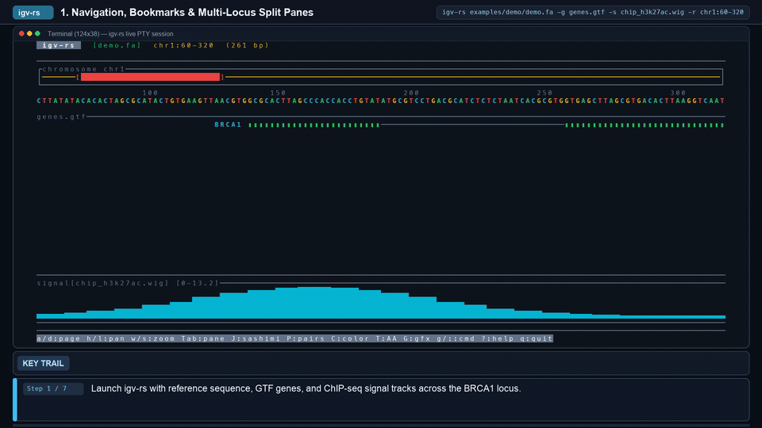

# 01 · Navigation, Bookmarks & Multi-Locus Split Panes

Explore large genomes rapidly from the keyboard: page and pan across chromosomes, zoom smoothly between chromosome-wide signal overviews and single-base sequence views, jump directly to any gene or transcript ID, pin temporary Vim-style bookmarks, and inspect up to four loci side-by-side in split panes.



**[Watch Full-HD Narrated Video (`.mp4` with Audio)](../videos/01-navigation-and-panes.mp4)** · [Back to Tutorial Index](../tutorials.md)

---

## Runnable Command

```bash
igv-rs examples/demo/demo.fa \
  -g examples/demo/genes.gtf \
  -s examples/demo/chip_h3k27ac.wig \
  -r chr1:60-320
```

---

## Keystrokes & Screen Actions

| Step | Key(s) Pressed | Screen HUD Label | What Happens on Screen |
|---|---|---|---|
| 1 | *(Startup)* | — | Opens `chr1:60-320` displaying nucleotide sequence, `BRCA1` exon/intron structure (`genes.gtf`), and H3K27ac ChIP-seq signal peaks (`chip_h3k27ac.wig`). |
| 2 | `d` / `a` / `l` / `h` | `d`, `a`, `l`, `h` | Pages one full window right (`d`) and back (`a`), then slides cleanly by 1/10 window steps (`l`, `h`). |
| 3 | `w` / `s` | `w`, `s` | Zooms in around the viewport midpoint (`w`) and zooms back out (`s`). |
| 4 | `:` `T` `P` `5` `3` `⏎` | `:TP53`, `Enter ⏎` | Opens the `:` command palette and resolves gene symbol `TP53` from `genes.gtf` to jump to `chr1:620-1080`. |
| 5 | `m` `a` → `d` → `'` `a` | `m`, `a`, `d`, `'`, `a` | Pins bookmark `a` at `TP53`, pages away with `d`, then recalls `'a` to return instantaneously. |
| 6 | `:split chr2:80-680` `⏎` → `Tab` | `Tab ⇥` | Splits the TUI horizontally across `chr1` (Pane 1) and `chr2` (`EGFR`, Pane 2), with `Tab` cycling focus and highlighting the active border. |
| 7 | `?` → `Esc` → `q` | `?`, `Esc`, `q` | Opens the interactive keybinding help overlay (`?`), dismisses it (`Esc`), and exits cleanly (`q`). |

---

## Written Narrative

1. **Opening the Locus View**: Launching `igv-rs` with a FASTA reference, GTF gene annotation file, and WIG signal track centers the viewport on `BRCA1` (`chr1:60-320`), showing the header locus pill, coordinate ruler, base sequence, transcript exons, and quantitative peak height.
2. **Coarse & Fine Panning**: `d` and `a` (or arrow keys `→` / `←`) jump by a full viewport width for fast scanning along a chromosome, while Vim-style `l` and `h` pan by one tenth of a window so you can nudge a splice site or SNP straight into center frame.
3. **Symmetrical Zooming**: Pressing `w` (or `↑`) zooms inward around the center base until individual letters and strand ticks resolve; pressing `s` (or `↓`) pulls back to wide overview scale while automatically gating expensive per-base fetches.
4. **Gene-Symbol Jump (`:TP53`)**: Pressing `:` or `g` opens the footer prompt. Typing any `gene_name`, `gene_id`, or `transcript_id` computes the union span of all matching isoforms on that chromosome and centers the browser there.
5. **Bookmarks (`m<c>` / `'<c>`)**: Comparing distal loci is frictionless with Vim-style marks—press `m` followed by a letter (`a`) to save the active region, explore downstream, and tap `'` followed by `a` to jump back.
6. **Multi-Locus Split Panes (`:split` / `Tab`)**: Running `:split chr2:80-680` creates an independent second pane for `EGFR` on `chr2` while keeping `TP53` pinned on the left. Pressing `Tab` switches keyboard/mouse focus between panes (`1..=4` supported; `:unsplit` closes the active pane).
7. **In-App Discovery**: Whenever you need a reminder, `?` renders a full keybinding and command cheat-sheet right inside the terminal, dismissed by `Esc` before quitting with `q`.
