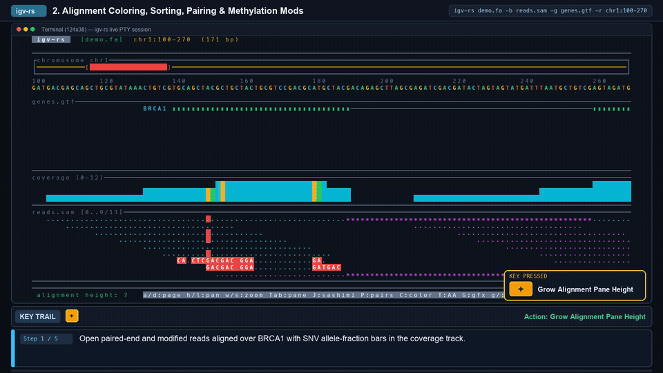

# 02 · Alignment Coloring, 5mC Methylation, View-as-Pairs & Sorting

Inspect `BAM`, `CRAM 3.0+`, `SAM`, and `PAF` alignments interactively with rich biological color schemes (`MM`/`ML` 5mC/5hmC/6mA modifications, bisulfite CpG status, insert size, pair orientation, mate chromosome, MAPQ, custom BAM tags), live single-locus read sorting, read grouping, paired-end mate linking, and soft-clip inspection.



**[Watch Full-HD Narrated Video (`.mp4` with Audio)](../videos/02-alignment-analytics.mp4)** · [Back to Tutorial Index](../tutorials.md)

---

## Runnable Command

```bash
igv-rs examples/demo/demo.fa \
  -b examples/demo/reads.sam \
  -g examples/demo/genes.gtf \
  -r chr1:100-270
```

---

## Keystrokes & Screen Actions

| Step | Key(s) Pressed | Screen HUD Label | What Happens on Screen |
|---|---|---|---|
| 1 | `+` → `j` → `k` | `+`, `j`, `k` | Expands alignment pane height (`+`) and scrolls read rows down (`j`) and back up (`k`) using the track scroll bar `[first..last/total]`. |
| 2 | `Shift + P` | `Shift + P` | Enables **View-as-Pairs**: joins forward and reverse paired-end mates onto the same horizontal row with dashed template connectors. |
| 3 | `Shift + C` (×4) | `Shift + C` | Cycles coloring modes live in the header/track badge: `strand` → `insert-size` (flags abnormally large inserts) → `pair-orientation` → `mapq` → `base-mod` (highlights `MM`/`ML` 5mC calls along reads). |
| 4 | `:sort base` `⏎` | `:sort base`, `Enter ⏎` | Sorts reads crossing the viewport center (`chr1:150` heterozygous `A`/`G` SNV) so mismatched `G` alleles stack above reference `A` alleles; coverage bar displays the yellow/blue allele-fraction split. |
| 5 | `:group hp` `⏎` → `:softclip on` `⏎` → `q` | `:group hp`, `:softclip on`, `q` | Separates reads into labeled `HP=1` and `HP=2` haplotype bands, then reveals soft-clipped `TTTTTT`/`AAAAAA` overhang bases (`6S`) at read ends. |

---

## Written Narrative

1. **Pileup Depth & Coverage SNV Bars**: Opening `reads.sam` above `BRCA1` immediately displays the coverage histogram with heterozygous mismatch allele-fraction ticks at `chr1:150` (`A`/`G` ~50/50 split) alongside read lanes below. Increasing pane height (`+`) and scrolling (`j`/`k`) reveals deeper coverage piles.
2. **View-as-Pairs (`Shift + P`)**: Paired-end genomics often requires checking insert span and mate integrity at a glance. Tapping `P` groups mate pairs onto shared lanes with template connectors so discordant pairs stand out immediately.
3. **8 Biological Coloring Modes (`Shift + C` or `:color`)**: Repeatedly pressing `C` cycles through `strand` (forward pink vs. reverse blue), `insert` (highlighting unexpectedly large fragments like `disc_01`), `pair` (RR/LL/RL anomalies), `mate` (inter-chromosomal translocation partners like `chim_01` → `chr2`), `tag`, `mapq` (low-confidence shading), `mod` (`MM`/`ML` SAMtags decoding methylated 5mC/5hmC/6mA bases with probability-scaled warmth), and `bisulfite` (`CG` methylation state).
4. **Center-Base SNV Stratification (`:sort base`)**: Running `:sort base` orders alignments by their base call at the center coordinate (`chr1:150`), cleanly separating variant-supporting haplotypes from wild-type reads (also supports `start`, `strand`, `mapq`, `insert`, `mate`, `tag`, and `hp`).
5. **Haplotype Grouping & Soft-Clips (`:group hp` / `:softclip on`)**: `:group hp` inserts explicit band headers partitioning `HP:i:1` and `HP:i:2` haplotypes (plus `rg`, `strand`, `pair`, `mate`, `tag`, `chimeric`), while `:softclip on` draws masked overhanging bases so adapter artifacts or structural breakpoint micro-homologies are directly visible.
