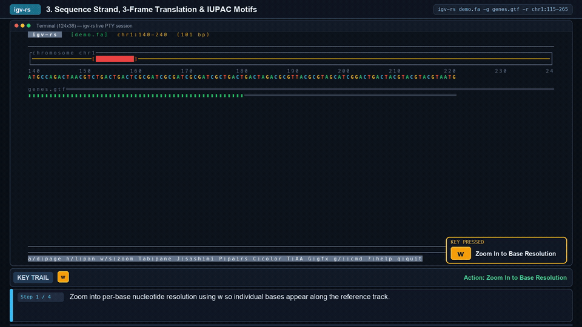

# 03 · Sequence Strands, 3-Frame Translation & IUPAC Motifs

Work directly with the reference sequence at nucleotide scale: switch between single-strand and dual complementary strands, toggle live 3-frame amino-acid translations (`M` start in green, `*` stop in red), flip to reverse-strand translation for minus-strand genes like `TP53`, and highlight IUPAC degenerate DNA motifs across both strands.



**[Watch Full-HD Narrated Video (`.mp4` with Audio)](../videos/03-sequence-and-motifs.mp4)** · [Back to Tutorial Index](../tutorials.md)

---

## Runnable Command

```bash
igv-rs examples/demo/demo.fa \
  -g examples/demo/genes.gtf \
  -r chr1:115-265
```

---

## Keystrokes & Screen Actions

| Step | Key(s) Pressed | Screen HUD Label | What Happens on Screen |
|---|---|---|---|
| 1 | `w` | `w` | Zooms smoothly into nucleotide-level view so every base `A/C/G/T` renders clearly in its classic IGV color. |
| 2 | `Shift + T` | `Shift + T` | Toggles **3-frame forward amino-acid translation** (`F1`, `F2`, `F3`) beneath the DNA track, coloring `M` start codons emerald and `*` stop codons red. |
| 3 | `:strand both` `⏎` → `:translate rev` `⏎` | `:strand both`, `:translate rev`, `Enter ⏎` | Adds the 3'←5' complementary nucleotide track (`A↔T`, `C↔G`) and switches the 3-frame decoder to reverse-complement reading frames (`R1`, `R2`, `R3`). |
| 4 | `:motif TATAWAW` `⏎` → `:motif GAATTC` `⏎` → `q` | `:motif TATAWAW`, `:motif GAATTC`, `q` | Searches the window on both strands using IUPAC degenerate codes (`W` = `A`/`T`), highlighting `TATAAAA` promoter boxes and EcoRI (`GAATTC`) restriction sites along the sequence bar. |

---

## Written Narrative

1. **Per-Base Sequence Track (`w`)**: At high zoom (`<= 50 kb` / narrow terminal window), `igv-rs` fetches sequence from indexed FASTA or random-access UCSC `.2bit` files and renders base-colored characters right beneath the coordinate tick ruler.
2. **3-Frame Amino-Acid Translation (`Shift + T`)**: Pressing `T` immediately expands three reading-frame tracks (`F1`, `F2`, `F3`), aligning amino-acid single-letter symbols to codon midpoints and emphasizing start codons (`M`) and termination stops (`*`) so open reading frames lining up with annotated `CDS` exons jump right out.
3. **Complement Strand & Reverse Frames (`:strand both`, `:translate rev`)**: When inspecting genes transcribed from the minus strand (such as `TP53`), run `:strand both` to inspect Watson/Crick base pairing directly and `:translate rev` to decode the reverse-complement reading frames (`R1`, `R2`, `R3`).
4. **IUPAC Motif & Restriction-Site Highlighting (`:motif <PATTERN>`)**: Enter any standard nucleotide regex or IUPAC ambiguity code—for example `:motif TATAWAW` (TATA box) or `:motif GAATTC` (EcoRI). `igv-rs` scans both strands across the active window, highlights matching positions directly in the sequence track, and reports exact match count in the footer status bar (`:motif off` clears).
