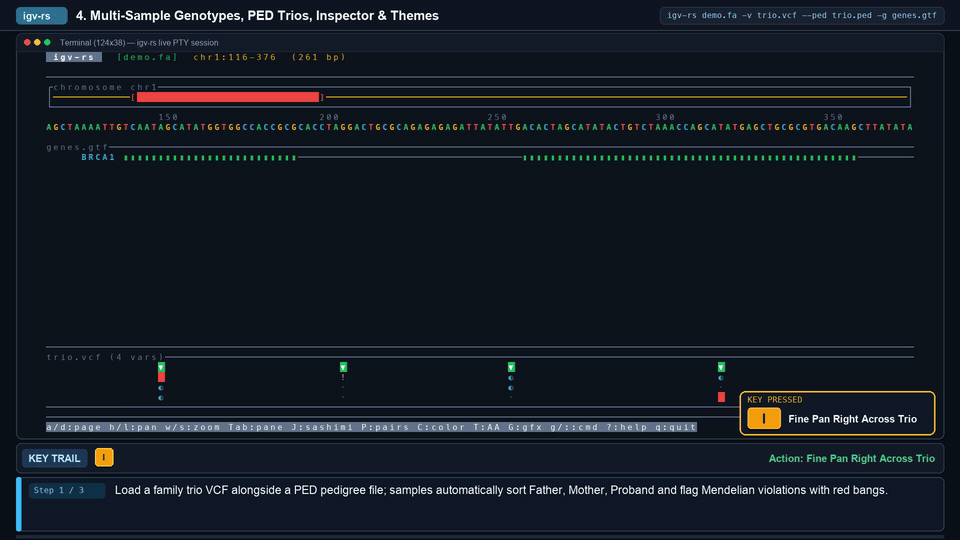

# 04 · Multi-Sample VCF/BCF Genotypes, PED Trios, Inspector & Themes

Visualize cohort and trio variant calls (`VCF`, `.vcf.gz`, and binary `BCF 2.2`), automatically order family samples (`Father` → `Mother` → `Proband`) via `PED` pedigrees, flag Mendelian inheritance violations directly in genotype rows, inspect exact allele/depth/trio metadata by clicking any feature, and switch across eight built-in terminal themes.



**[Watch Full-HD Narrated Video (`.mp4` with Audio)](../videos/04-variants-and-pedigree.mp4)** · [Back to Tutorial Index](../tutorials.md)

---

## Runnable Command

```bash
igv-rs examples/demo/demo.fa \
  -v examples/demo/trio.vcf \
  --ped examples/demo/trio.ped \
  -g examples/demo/genes.gtf \
  -r chr1:90-350
```

---

## Keystrokes & Screen Actions

| Step | Key(s) Pressed | Screen HUD Label | What Happens on Screen |
|---|---|---|---|
| 1 | `l` → `h` | `l`, `h` | Pans subtly across the `trio.vcf` sample genotype matrix where `Father`, `Mother`, and `Proband` rows show `0/0`, `0/1`, `1/1` color blocks and red `!` alerts at `chr1:205` (`rs1003` *de novo* Mendelian violation). |
| 2 | `🖱 Click` on variant track → `Esc` | `🖱 Click`, `Esc` | Opens the **Modal Variant Inspector** popup displaying `Locus`, `ID`, `Alleles`, `QUAL/Filter`, `AF`, per-sample genotypes, and `[MENDELIAN VIOLATION]` tags; `Esc` closes the modal. |
| 3 | `t` (×4) → `q` | `t`, `q` | Cycles terminal color palettes across `light`, `paper`, `dracula`, and `gruvbox-dark` before exiting cleanly (`q`). |

---

## Written Narrative

1. **PED-Ordered Multi-Sample Genotypes**: Providing `--ped trio.ped` alongside `-v trio.vcf` automatically arranges sample rows in family order (`Father`, `Mother`, `Proband`) inside the variant track, displaying homozygous reference, heterozygous, and homozygous alternate blocks per sample.
2. **Real-Time Mendelian Violation Detection**: Every site with valid parental calls is checked against Mendelian transmission rules. At `chr1:205` (`rs1003`), where both `Father` and `Mother` are homozygous reference `0/0` while `Proband` carries a `0/1` alternate call, `igv-rs` flags the variant cell with a bold red `!` indicator.
3. **Interactive Mouse Hit-Testing & Modal Inspector**: Clicking anywhere on the variant track (as well as reads, gene transcripts, or GWAS Manhattan markers; click/drag on the coordinate ruler or ideogram jumps/zooms) opens a crisp floating **Inspector** window summarizing variant ID, alleles, allele frequency, quality, and `[MENDELIAN VIOLATION]` flags. Press `Esc`, `Enter`, or `q` (or click anywhere) to dismiss.
4. **8 Built-In Color Themes (`t`)**: Tapping `t` rotates smoothly through `dark`, `light`, `paper`, `solarized-dark`, `solarized-light`, `dracula`, `gruvbox-dark`, and custom TOML overrides—equally usable on dark developer consoles and bright projector screens.
