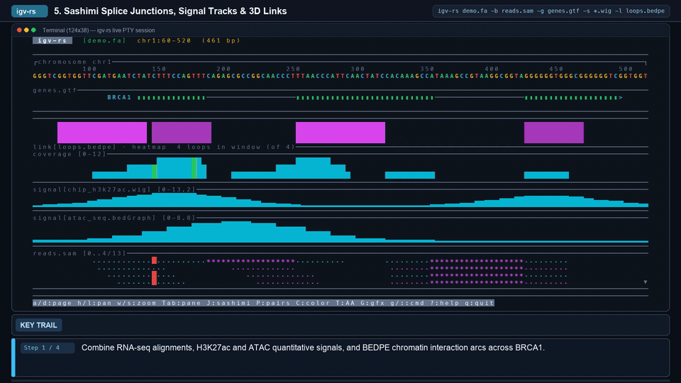

# 05 · RNA-seq Sashimi Splice Junctions, Quantitative Signals & 3D Links

Bring multi-omics layers together in one synchronized view: compute live RNA-seq Sashimi splice-junction arcs directly from spliced `N`-operator alignments, overlay continuous ChIP-seq / ATAC-seq tracks (`bigWig`, `WIG`, `bedGraph`) with configurable shared or per-track Y-scales and summary functions, and inspect `BEDPE` / `bigInteract` 3D chromatin loops.



**[Watch Full-HD Narrated Video (`.mp4` with Audio)](../videos/05-sashimi-signals-and-links.mp4)** · [Back to Tutorial Index](../tutorials.md)

---

## Runnable Command

```bash
igv-rs examples/demo/demo.fa \
  -b examples/demo/reads.sam \
  -g examples/demo/genes.gtf \
  -s examples/demo/chip_h3k27ac.wig \
  -s examples/demo/atac_seq.bedGraph \
  -l examples/demo/loops.bedpe \
  -r chr1:60-520
```

---

## Keystrokes & Screen Actions

| Step | Key(s) Pressed | Screen HUD Label | What Happens on Screen |
|---|---|---|---|
| 1 | *(Initial view)* | — | Displays `BRCA1` (`genes.gtf`), 3D promoter-enhancer arcs (`loops.bedpe`), H3K27ac (`chip_h3k27ac.wig`), ATAC-seq (`atac_seq.bedGraph`), coverage depth, and spliced reads. |
| 2 | `Shift + J` | `Shift + J` | Enables **RNA-seq Sashimi Plot**, aggregating `69N` CIGAR intron skips into junction arcs between `BRCA1` exons `[60..190]→[260..360]` (`6` reads) and `[260..360]→[430..520]` (`4` reads). |
| 3 | `}` → `>` → `\` → `:summary mean` `⏎` | `}`, `>`, `\`, `:summary mean` | Expands signal track height (`}`), expands link arc height (`>`), toggles shared vs. per-track Y-scale (`\`), and switches window aggregation from `max` to `mean`. |
| 4 | `d` → `a` → `q` | `d`, `a`, `q` | Pans across neighboring locus `TP53` (`d`), returns to `BRCA1` (`a`), and exits cleanly (`q`). |

---

## Written Narrative

1. **Unified Multi-Omic Stacking**: `igv-rs` stacks annotations, chromatin links (`BEDPE`/`bigInteract`), quantitative continuous tracks (`bigWig`, `WIG`, `bedGraph`), coverage, Sashimi junctions, and read alignments along a single pixel-aligned genomic ruler.
2. **Sashimi Splice-Junction Visualization (`Shift + J` / `--sashimi`)**: Tapping `J` computes junction span support from spliced alignment CIGAR `N` operators on the fly and draws parabolic splice curves labeled with supporting read counts right beneath the coverage histogram—matching `BRCA1`'s exact exon-intron boundaries.
3. **Interactive Track Sizing & Y-Scale Normalization (`}`, `>`, `\`)**: Each track type has dedicated keyboard resize controls (`+`/`-` alignments, `]`/`[` coverage, `}`/`{` signals, `>`/`<` links). Pressing `\` switches multiple signal tracks between independent local scaling and a common shared Y-maximum (`chip_h3k27ac.wig` vs. `atac_seq.bedGraph`) so peak intensities can be compared quantitatively.
4. **Signal Window Aggregation (`:summary max|mean|min|sum`)**: At wide or intermediate windows where multiple data bins map to one terminal column or SVG pixel, `:summary` lets you inspect peak maxima (`max`), average signal (`mean`), floor (`min`), or cumulative counts (`sum`).
5. **Sparse vs. Dense 3D Link Rendering**: Low-density `BEDPE` / `bigInteract` windows draw crisp Bézier/block arcs (and mark off-chromosome `trans_fusion_sv` breakpoints to `chr2`), while high-density intervals automatically summarize into compact interaction heatmaps.
