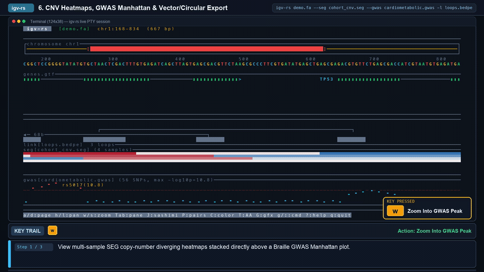

# 06 · CNV Heatmaps, GWAS Manhattan Plots & Vector / Circular Exports

Analyze cohort-scale copy-number variations (`SEG`/`CBS`/`CN`) and genome-wide association summary statistics (`GWAS`/`ASSOC`) inside high-resolution Braille and half-block terminal panels, then export publication-ready regional SVG/PNG figures or whole-genome Circos-style SV + CNV chord plots.



**[Watch Full-HD Narrated Video (`.mp4` with Audio)](../videos/06-cnv-gwas-and-snapshots.mp4)** · [Back to Tutorial Index](../tutorials.md)

---

## Runnable Command

```bash
igv-rs examples/demo/demo.fa \
  --seg examples/demo/cohort_cnv.seg \
  --gwas examples/demo/cardiometabolic.gwas \
  -l examples/demo/loops.bedpe \
  -g examples/demo/genes.gtf \
  -r chr1:1-1000
```

---

## Keystrokes & Screen Actions

| Step | Key(s) Pressed | Screen HUD Label | What Happens on Screen |
|---|---|---|---|
| 1 | `w` → `d` → `a` | `w`, `d`, `a` | Zooms in and pans across the diverging red/white/blue **CNV Heatmap** (`Tumor_01..03`, `Normal_01`) and high-density **Braille GWAS Manhattan Plot** peaking at `chr1:220` (`p = 1.2e-11`, `-log10(p) ≈ 10.9`). |
| 2 | `Shift + S` | `Shift + S` | Exports an instant auto-named vector SVG (`snapshot_chr1_...svg`) capturing every active track including CNV, GWAS, genes, and links. |
| 3 | `:snapshot panel.png` `⏎` | `:snapshot panel.png`, `Enter ⏎` | Rasterizes a crisp PNG figure (`panel.png`) directly from the pure-Rust `igv-render` SVG/PNG pipeline (`usvg` + `resvg`). |
| 4 | `:circular circos.svg` `⏎` → `q` | `:circular circos.svg`, `q` | Generates a whole-genome **Circos-style Circular SV & CNV Chord Diagram** showing chromosome ideogram arcs (`chr1`, `chr2`), CNV log2 rings, and inter/intra-chromosomal `BEDPE` chords, then exits (`q`). |

---

## Written Narrative

1. **Multi-Sample SEG Copy-Number Heatmaps (`--seg`)**: `igv-rs` renders copy-number segmentation matrices using `▀` half-block subpixels so two sample tracks fit cleanly per terminal row. Gains (`log2 > 0`, e.g. `+1.45` in `Tumor_01`) glow warm red, deletions (`log2 < 0`, e.g. `-1.35`) appear deep blue, and diploid `Normal_01` stays neutral.
2. **Subpixel Braille GWAS Manhattan Plots (`--gwas`)**: Association summary tables (`SNP`, `CHR`, `BP`, `P`) render in `2×4` Unicode Braille subpixels (`⣿`), plotting `-log10(p)` across the active coordinate range with dashed `p = 5e-8` significance threshold markers.
3. **One-Key Vector & Raster Snapshots (`Shift + S`, `:snapshot`)**: At any moment, press `S` to write a publication-grade vector `.svg` to your working directory, or use `:snapshot path.png` / `--snapshot-bed` / `--snapshot-genes` for automated multi-panel exports with light `igv` publication styling.
4. **Whole-Genome Circular SV & CNV Plots (`:circular` / `--circular-out`)**: Running `:circular circos.svg` (or `--circular-out circos.png` from the CLI) arranges all reference chromosomes around a circular ideogram, layers copy-number segments as inner radial arcs, and traces long-range structural variants and translocations (`loops.bedpe`) as smooth quadratic Bézier chords through the circle center.
