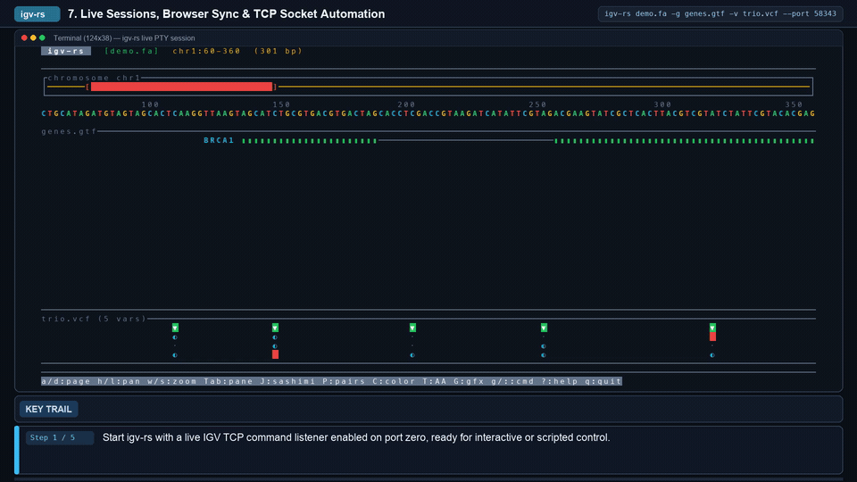

# 07 · Live Track Hot-Loading, Sessions, Browser Sync & TCP Automation

Treat `igv-rs` as an extensible genomics workstation or scriptable server: load and unload tracks on the fly without restarting, persist/restore workspace state via `.toml` or IGV `.json` sessions, pair bidirectionally with the embedded `igv.js` web UI, and steer the live TUI remotely over `--port` TCP sockets or `--batch` scripts.



**[Watch Full-HD Narrated Video (`.mp4` with Audio)](../videos/07-sessions-batch-and-automation.mp4)** · [Back to Tutorial Index](../tutorials.md)

---

## Runnable Command

```bash
igv-rs examples/demo/demo.fa \
  -g examples/demo/genes.gtf \
  -v examples/demo/trio.vcf \
  --port 60151 \
  -r chr1:60-360
```

Send an external TCP command from another terminal or pipeline tool:

```bash
printf 'goto chr1:620-1080\n' | nc 127.0.0.1 60151
```

Or execute a full reproducible workflow headlessly via `--batch`:

```bash
igv-rs --batch examples/demo/batch_example.igv
```

---

## Keystrokes & Screen Actions

| Step | Key(s) / Event | Screen HUD Label | What Happens on Screen |
|---|---|---|---|
| 1 | *(Startup with `--port`)* | — | Opens `chr1:60-360` with an IGV-compatible TCP command listener active on `127.0.0.1:<port>`. |
| 2 | `:load examples/demo/atac_seq.bedGraph` `⏎` → `:save-session work.toml` `⏎` | `:load`, `:save-session`, `Enter ⏎` | Dynamically opens `atac_seq.bedGraph` without restarting (`:load`), renders the new track live, and serializes genome/regions/tracks/render options into `work.toml` (`:save-session`). |
| 3 | `Shift + B` | `Shift + B` | Starts the offline-capable `igv-serve` HTTP bridge serving `igv.js` with two-way SSE (`TUI → browser`) and `POST /api/locus` (`browser → TUI`) synchronization. |
| 4 | External TCP command `goto chr1:620-1080` | `TCP ⇄` | Demonstrates a remote script jumping the running TUI straight to `TP53` (`chr1:620-1080`) over the live TCP socket. |
| 5 | `:unload atac_seq` `⏎` → `q` | `:unload atac_seq`, `q` | Removes matching track(s) cleanly from memory (`:unload`) and shuts down the session and HTTP server on quit (`q`). |

---

## Written Narrative

1. **Dynamic Track & Genome Management (`:load`, `:unload`, `:genome`)**: You never have to restart a session when a new QC track finishes—type `:load path_or_url` (supporting BAM/CRAM/VCF/GTF/BED/bigWig/WIG/BEDPE/SEG/GWAS or UCSC Hub URLs) to hot-mount tracks immediately, `:genome hg38` to switch reference assemblies, or `:unload <pattern>` to remove clutter.
2. **Portable Sessions (`--session`, `:save-session`, `:load-session`)**: Save exact multi-pane coordinates, tracks, color/sort/group modes, Sashimi visibility, and themes to clean TOML (`work.toml`), or load desktop/web IGV `.json` session files directly at startup.
3. **Bidirectional `igv.js` Browser Companion (`Shift + B`)**: Pressing `B` starts an embedded HTTP/range server (`igv-serve`). Navigating in `igv-rs` pushes SSE viewport updates to `igv.js`, while dragging/searching inside the browser posts `/api/locus` events back so both views stay locked in step.
4. **Live IGV Socket Listener (`--port 60151`)**: Just like desktop IGV's port listener, `--port` accepts line-oriented commands (`goto <locus>`, `load <path>`, `snapshot <file>`, `sort`, `group`, `colorBy`, `echo`), replying `OK`—ideal for Jupyter notebooks, Snakemake pipelines, or Vim/Neovim integrations.
5. **Headless `--batch` Script Runner**: For reproducible CI figures and core-facility reports, `--batch script.igv` executes desktop-style batch scripts (`new`, `genome`, `load`, `snapshotDirectory`, `goto`, `colorBy`, `sort`, `sashimi`, `snapshot`, `circular`, `exit`) completely offscreen with zero TTY required.
